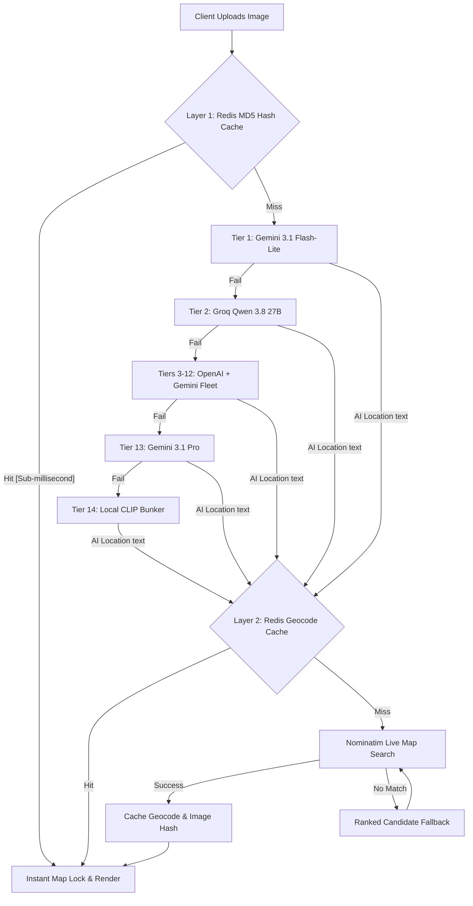

# 📍 PROJECT PINPOINT
### *A Production-Grade, 14-Tier Federated AI Discovery & Geolocation Engine*

[](https://nextjs.org/)
[](https://fastapi.tiangolo.com/)
[](https://upstash.com/)
[](https://render.com/)
[](https://vercel.com/)
[](LICENSE)

---

**Project Pinpoint** is a state-of-the-art, open-source AI reverse-image geoguessing and vector coordinate engine. Built on a **14-tier cloud-native federated fallback network**, Pinpoint leverages the world's most powerful vision models alongside a localized offline bunker (CLIP) to identify physical coordinates from real-world scenery or procedural game maps instantly.

---

## 🔑 Bring Your Own Key

Pinpoint does **not** require you to trust a hosted instance with your model budget.

* Paste a **Groq**, **Gemini** or **OpenAI** key into **Settings → Neural Link Override** and it is used for your scans instead of the server's.
* Keys travel with a single scan request. The server **never** writes them to disk, to the cache, to the Discovery Vault, or to the log.
* By default they live only in memory and disappear when the tab closes. *Remember keys on this device* opts into `localStorage` — convenient, but readable by any script on that origin, so it is off by default.
* Results produced with your own key are cached in a separate namespace, so they never mix with (or overwrite) the shared cache.

The same keys can be provided server-side through environment variables (see `.env.example`). A BYOK key always wins over the server's key for that provider.

---

## 🧠 14-Tier Neural Pipeline & Architecture

When an image is submitted, Pinpoint runs it through a stateful architecture designed for sub-second responses and flawless map locking:



### The ladder

| Tier | Provider | Model | Notes |
|------|----------|-------|-------|
| 1 | Gemini | `gemini-3.1-flash-lite` | Lead. Fast, cheap, strong spatial reasoning |
| 2 | Groq | `qwen/qwen3.8-27b` | Speed tier. Sub-second backup |
| 3 | OpenAI | `gpt-4o` | Strongest single vision model |
| 4 | OpenAI | `gpt-4o-mini` | Cheap, still multimodal |
| 5–8 | Gemini | `3.6-flash`, `3.5-flash`, `3.7-flash`, `3.8-flash` | Mid fleet |
| 9–12 | Gemini | `3.5-flash-lite`, `3-flash-preview`, `2.5-flash`, `2.5-flash-lite` | Cost floor |
| 13 | Gemini | `gemini-3.1-pro-preview` | Strongest Gemini, slow and quota hungry |
| 14 | Local | `clip-vit-base-patch32` | **Offline bunker.** No key, no network |

Each rung is skipped automatically when its provider has no key, so the effective ladder is as long as the keys you have. A scan also carries a wall-clock budget (`SCAN_DEADLINE_SECONDS`, default 90s) so a long outage cannot hold a request open indefinitely.

> **Note on GitHub Models:** the former GitHub rungs were removed. GitHub retired the entire GitHub Models service — playground, catalog, inference API and BYOK — on **2026-07-30**, so those rungs could never fire again. Their slots went to current Gemini models and to OpenAI.

---

## 🌟 Key Architectural Achievements

### 🚀 1. The 14-Tier Federated Alliance
Designed with a "Continuous Operation" philosophy. The engine automatically cascades through **13 cloud models** and falls back to a **local, lazy-loaded neural network (CLIP)** if the internet is fully severed.
*   **Lead Tier:** `Gemini-3.1-flash-lite` (optimizing for high-accuracy spatial and regional reasoning).
*   **Speed Tier:** `Groq Qwen 3.8 27B` (sub-second backup).
*   **Offline Backup:** Local CLIP bunker running `clip-vit-base-patch32` against a 92-place label pool, with prompt ensembling.

### 💾 2. Dual-Layer Redis Caching (Upstash & Local)
Protects API rate limits and accelerates repeated scans to **0ms latency**:
*   **Layer 1 (Image Hash Cache):** Computes MD5 of image files. Identical pictures completely bypass the AI stack.
*   **Layer 2 (Geocoding Cache):** Saves exact coordinates of found locations, protecting Nominatim from rate limits.

Cache entries are namespaced by a one-way fingerprint of the keys that produced them, so BYOK results stay separate from shared results.

### 🗺️ 3. Strict Map Lock with a Ranked Candidate Parser
Fuzzy administrative regions and conversational model responses (*"This image was taken at Abisko, Sweden..."*) are parsed automatically. The parser produces a **ranked list** of place candidates — the full name first, then progressively looser forms (`Paris, France`, then `Eiffel Tower, France`) — and the first candidate that geocodes wins. Non-answers such as `N/A` or `Unknown` are rejected rather than silently pinned to an arbitrary village.

### 🎮 4. Cyberpunk Game-Mode & Seed Cracker (S00N)
Switches the neural stack into a procedural vector calculator. Pinpoint analyzes game screenshots (Minecraft, GTA V, etc.), extracts natural terrain details, and cracks:
*   The exact natural biome (Plains, Forest, etc.)
*   Procedural XYZ Coordinates
*   Highly unique 10-digit World Seeds
*   The dimension and game version

Game mode requires a cloud model — the local CLIP bunker cannot crack a seed, and the API says so plainly instead of returning a fabricated one.

---

## 🔒 Privacy & Hardening

*   **Images are never stored.** They are parsed in memory and discarded.
*   **BYOK keys are never stored** by the server.
*   **Uploads are size-capped** (default 12 MB) and rejected with HTTP 413 before they can exhaust memory.
*   **Scans run off the event loop** on a worker thread, so one slow provider cannot stall the whole API.
*   **Per-IP rate limiting** protects the deployment's own keys (default 30 requests/minute).
*   **Confidence is honest.** The local bunker reports its own CLIP score (typically low); cloud tiers report a score that reflects how specific the answer was, rather than a flat 99%.

---

## 🚀 Cloud Deployment Guide

Pinpoint is fully optimized to run on free-tier cloud architectures.

### Phase 1: Database (Upstash)
1. Register a free account at [Upstash.com](https://upstash.com).
2. Create a serverless Redis database named `pinpoint-cache`.
3. Copy the secure connection URL (`rediss://default:...`).

### Phase 2: Backend (Render)
1. Connect to [Render.com](https://render.com) and deploy a new **Web Service** linked to the Git repository.
2. Set the `backend` directory as the Root Directory.
3. Configure the environment:
   * **Build Command:** `pip install -r requirements.txt`
   * **Start Command:** `uvicorn main:app --host 0.0.0.0 --port 10000`
4. Add the following Environment Variables under settings:
   * `REDIS_URL` = (The copied Upstash connection string)
   * `GROQ_API_KEY`, `GOOGLE_API_KEY`, `OPENAI_API_KEY` (any subset — every key is optional)

> The local CLIP bunker is **not** installed by default on Render, because `torch` is a heavy download that does not fit a free-tier build comfortably. Add `pip install -r requirements.txt -r requirements-local.txt` to the build command if you want tier 14.

### Phase 3: Frontend (Vercel)
1. Log into [Vercel.com](https://vercel.com) and import the repository.
2. Set the Root Directory to `frontend`.
3. Configure the following Environment Variable:
   * `NEXT_PUBLIC_API_URL` = (The live URL of the deployed Render Web Service)
4. Click **Deploy**!

---

## 💻 Local Development Quickstart

### 1. Run the Local Redis Container (optional — the API runs fine without it)
```bash
docker run --name pinpoint-redis -d -p 6379:6379 redis:alpine
```

### 2. Run the Backend
```bash
cd backend
python3 -m venv venv
source venv/bin/activate   # On Windows use `venv\Scripts\activate`
pip install -r requirements.txt
python main.py
```

To enable the offline CLIP bunker (tier 14), also install the optional extras:
```bash
pip install -r requirements-local.txt
```
The weights download once into `backend/models/` and are reused on every run.

Copy `.env.example` to `.env` in the repository root and add whichever keys you have. With no keys at all the API still starts — it simply reports that no tier is reachable.

### 3. Run the Frontend
```bash
cd frontend
npm install
npm run dev
```

Open `http://localhost:3000` to access the neural scanner dashboard.

### 4. Audit your tier ladder
```bash
cd backend
python -m app.audit_brains
```
Probes every rung against its provider and prints which ones are reachable.

---

## 💎 Credits

**Project Pinpoint** is made possible by the incredible open-source libraries, APIs, and services created by these organizations:

*   **Pinpoint Developer:** [@velo4705](https://github.com/velo4705) (Lead Architect)
*   **Neural AI Models:**
    *   **Google DeepMind** for the highly versatile `Gemini` vision model fleet.
    *   **Groq Alliance** for blazing-fast inference via the `Qwen 3.8 27B` accelerator.
    *   **OpenAI** for the `GPT-4o` vision family.
    *   **Hugging Face / CLIP** for the airgapped offline vision classifier.
*   **Geospatial & Vector Mapping:**
    *   **MapLibre GL** for fast, high-performance GPU-rendered canvas layers.
    *   **Esri World Imagery** for high-resolution satellite raster feeds.
    *   **CartoDB & OpenStreetMap** for sleek dark-matter vector mapping.
*   **Database & Frameworks:**
    *   **FastAPI & Uvicorn** for the backend async routing engine.
    *   **Next.js & TailwindCSS** for the gorgeous "Neural OS" glassmorphism dashboard.
    *   **Upstash** for the lightning-fast serverless Redis caching layer.

---

## 🤝 Contributing
Contributions to the procedural game vector models or frontend dashboard are highly appreciated! Feel free to fork the repository and open a Pull Request.

## 📜 License
Distributed under the MIT License. See `LICENSE` for details.

---
*Developed with ❤️ for explorers and geospatial intelligence hackers.*
